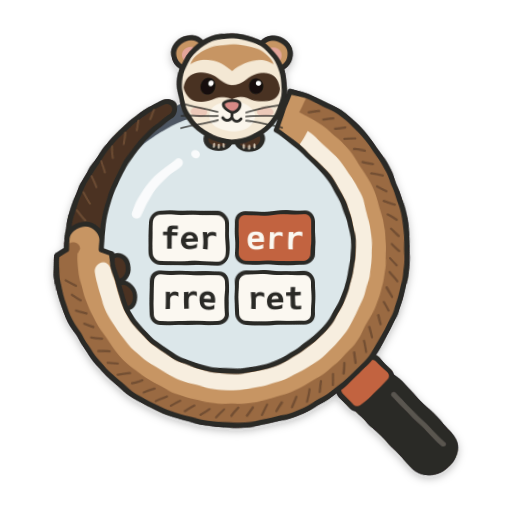
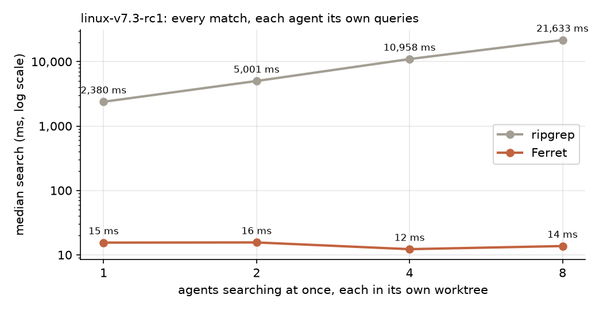

<p align="center">
  
</p>

<h1 align="center">Ferret</h1>

<p align="center">
  <strong>Code search for coding agents that share a repository.</strong><br>
  One index for every git worktree, uncommitted edits searchable within 13 ms, and an MCP server for agents.
</p>

<p align="center">
  <a href="docs/DEVELOPMENT.md"></a>
  <a href="#build"></a>
  <a href="#the-mcp-tools"></a>
  <a href="LICENSE"></a>
</p>

<p align="center">
  <a href="https://yllkryeziu.github.io/#work/ferret">Blog post</a> ·
  <a href="#results">Results</a> ·
  <a href="#how-it-works">How it works</a> ·
  <a href="#quickstart">Quickstart</a> ·
  <a href="#the-mcp-tools">MCP tools</a>
</p>

Ferret is a local code search engine and MCP server for coding agents,
built for several agents working on one repository at once. It indexes a git
repository once, and every worktree of that repository shares the one index,
because the index is keyed by file content (the git blob), not by path.
Uncommitted edits are searchable within milliseconds, and a search that
follows an edit sees it (read-your-writes). Results are ranked and come in a
shape and size an agent can use. Ferret runs on one machine (macOS, arm64);
it is not a distributed service.

The blog post [How code search works, and what coding agents need from
it](https://yllkryeziu.github.io/#work/ferret) walks through the design with
interactive figures.

## Results

Four questions, each comparing Ferret with ripgrep, which coding agents run
today, and Zoekt, the most widely used open-source code index. On a MacBook
Air M3 with Linux v7.3-rc1 (96,022 files) and Chromium (507,575 files);
[bench/README.md](bench/README.md) has the method and
[bench/results/2026-10-06](bench/results/2026-10-06/README.md) every table.

| | Ferret | Zoekt | ripgrep |
| --- | ---: | ---: | ---: |
| **Search**, median over 200 queries, every match: Linux | 0.3 ms | 0.8 ms | 2.2 s |
| Chromium | 1.3 ms | 1.6 ms | 15.5 s |
| **Eight agents searching at once**, each in its own worktree, median search: Linux | 14 ms | – | 21.6 s |
| **Another worktree**, at a commit that changes 0.5% of the files: Linux | 1.5 s, 10 MiB | 96 s<br><sub>rebuild</sub> | 0 s<br><sub>no index</sub> |
| **Edit until a search finds it**, median: Linux | 11 ms | 261 ms<br><sub>commit, update, reload</sub> | 0 ms<br><sub>reads every file</sub> |

<p align="center">
  
</p>

Ferret's search times leave out its default wait for recent edits, about
12 ms, which Zoekt does not need because it never sees uncommitted edits;
the agents row includes it. Ferret returned the same lines as ripgrep for
all 200 queries on each repository; Zoekt for 189 on Linux and 157 on
Chromium, because its defaults skip files that contain a NUL byte or more
than 20,000 distinct trigrams. Neither index is faster across the board. Zoekt is faster
on common words that match hundreds of thousands of lines (95th percentile
on Chromium: 42 ms against 102 ms), because it stores trigram positions;
Ferret's index is half the size (3.3 GiB against 6.6 GiB on Chromium) and
faster on regexes (95th percentile 27 ms against 154 ms).

**Agents.** In a pre-registered experiment, Codex CLI with gpt-6-luna
localized real Linux and Chromium bugs with ripgrep or with Ferret. With four
agents at once, the agents with Ferret finished 15% faster (wall time 0.85x,
95% CI [0.76, 0.95]) but used 35% more tokens, because they searched more
often. The [blog post](https://yllkryeziu.github.io/#work/ferret) has the details.

## How it works

The [blog post](https://yllkryeziu.github.io/#work/ferret) explains each idea with interactive figures.

* **Trigram index over chunks.** Files are cut at line breaks into chunks of
  about 8 KiB. Posting lists store chunk numbers as bit-packed gaps, decoded
  and intersected with SIMD (NEON) kernels. Case is folded at build time, so
  a case-insensitive query needs one lookup per trigram.
* **Regex planning.** RE2's parse tree becomes a query over trigrams (AND,
  OR, and the union of trigrams containing a 1- or 2-byte literal); RE2 then
  verifies candidates in linear time.
* **Exact top-K with an early stop.** Documents are stored in static-rank
  order, and the search stops once no remaining candidate can beat the
  K-th best file, with name-aware and code-token bounds. Results equal an
  exhaustive search's at 1 to 8 threads.
* **One index for every worktree.** The index is keyed by git blob ID; each
  worktree is a persistent map from path to blob. A worktree costs work in
  proportion to its diff, and identical content is stored once.
* **Read-your-writes.** Before a search, Ferret writes a cookie file into the
  worktree and waits for its FSEvents notice; notices arrive in order, so
  every earlier write is in. A search that cannot confirm this within a
  second runs anyway and is marked stale.
* **An MCP server for agents.** `search`, `find_symbol` (tree-sitter
  definitions for C, C++ and Python) and `index_status`, with byte budgets,
  ranked context, and empty searches that answer with what would have
  matched.

## Build

The tested platform is macOS arm64. [docs/DEVELOPMENT.md](docs/DEVELOPMENT.md)
lists the toolchain: Bazelisk (Bazel 9.2), Apple clang, Go, Python 3.13, uv,
Bash 4 or later.

```sh
bazel build -c opt //ferret/cli:ferret     # binary: bazel-bin/ferret/cli/ferret
```

## Quickstart

### One-shot search: `ferret index` and `ferret search`

`ferret index` builds an index file and `ferret search` queries it, with no
daemon. `--index` picks the file (the default is a per-worktree file under
`$XDG_CACHE_HOME/ferret`, or `~/.cache/ferret`). `ferret search` reads the
file that `ferret index` wrote. That file is separate from the per-repository
index directory that the daemon (`serve`, `mcp`) uses, and neither reads the
other.

```console
$ ferret index --root=. --index=demo.fidx
Indexed 4 of 4 files (451 B) into demo.fidx (400.0 KiB) in 59ms
  segment: 4 docs, 4 chunks, 198 trigrams, 310 postings (96 B)

$ ferret search --root=. --index=demo.fidx OnConnectionError
4 matching lines in 4 files

src/net/conn.cc
2-
3-// Report a connection failure to the caller.
4:void OnConnectionError(int code) {
5-  LogError("connection failed", code);
6-}
...
README.md
2:Call OnConnectionError when Dial fails.
```

Source files rank first, then tests, then documentation. Matching is
case-insensitive by default. Useful flags (see `ferret --helpfull`):
`--regex`, `--case_sensitive`, `--path=GLOB`, `--shape=raw|line|context|locations`
(default `context`), `--context`, `--max_files`, `--max_lines_per_file`,
`--max_bytes`, `--backend=index|ripgrep`, `--stats`. Exit status follows grep
(0 match, 1 none, 2 error). `ferret plan [--explain] PATTERN` shows the trigram
query for a pattern.

### The daemon and MCP: `ferret serve` and `ferret mcp`

`ferret serve [ROOT]` runs one daemon per repository on a per-user Unix
socket. It prints nothing and exits after `--idle_timeout` (30 minutes)
without clients. `ferret mcp` starts one if none runs.

`ferret mcp [ROOT ...]` speaks MCP over stdio through the daemon, keeps its
index under `--index_dir` (default: the platform cache), and registers each
ROOT (default `.`). All worktrees of one repository share one index.
`--standalone` runs the engine inside the MCP process.
`--serve_consistency=sync` (default) makes each search wait for the file
watcher so it sees earlier writes; `none` skips the wait. `--shape` sets the
default shape. A piped session, replies trimmed to `text`:

```console
$ ferret mcp --index_dir=idx .
> tools/call search {"pattern":"OnConnectionError","shape":"locations"}
< src/net/conn.cc:4  src/net/conn.h:2  tests/conn_test.cc:2  README.md:2
> tools/call find_symbol {"name":"OpenConnection"}
< src/net/conn.cc:8: definition function int OpenConnection(const char* host) {
< src/net/conn.h:3: declaration function int OpenConnection(const char* host);
> (append a line to src/net/conn.cc, uncommitted; then search for it)
< src/net/conn.cc:11:void FreshlyEditedFunction() {}
```

`find_symbol` extracts in the background: right after startup it answered
`No symbols found.` with `3 files pending extraction.`

### Experiment flags

These `ferret mcp` flags exist for the agent experiments in `eval/`.
Each appears in `--helpfull` and was run once over piped JSON-RPC.

* `--fixed_shape`: do not expose or accept a model-supplied shape. `tools/list`
  then has no `shape` property in `search`, and a call that passes it fails
  with `unknown search argument: shape`. Use `--shape` to set the one shape.
* `--spawn_daemon=false`: never start a daemon. With none running, a tool call
  returns an error (`connect daemon: Connection refused`) and the MCP session
  continues. With `ferret serve` running, calls succeed.
* `--router`: structural routing, which requires `--shape=context`
  (`--router --shape=line` exits with `--router requires --shape=context`).
  For an identifier search that matches more than 20 files, the reply can be
  the structural response instead of the text one. On a generated repo with 31
  files, one definition, and 30 callers, `search handle_request` returned a
  header `Structural route: 61 text matches in 31 files; token_precision
  0.508197; 1 definitions; ...`, then `Definitions:` (`src/core.c:1:...`) and
  `References:` grouped by file with call-site counts.

### Add Ferret to Claude Code

```sh
claude mcp add --scope project ferret -- /path/to/ferret mcp
```

This writes a `.mcp.json` entry (`"type": "stdio"`, `"command"`, `"args":
["mcp"]`) that you can also write by hand. With no ROOT,
`ferret mcp` indexes its working directory. The first registration of a large
repository takes a while: about 30 s for Linux and 2 minutes for Chromium.

## The MCP tools

The schemas are in `ferret/mcp/search_tools.cc`. Unknown arguments are
rejected, and bad patterns or globs return a correctable tool error.

* **`search`**: search the lines of a worktree. Required: `pattern`. Optional:
  `patterns` (up to 16 more, searched with `pattern` in one pass), `regex`
  (false), `case_sensitive` (false), `path_glob` (all paths), `max_files`
  (10; 0 means no limit), `context_lines` (2, up to 100), `shape` (`raw`,
  `line`, `context`, `locations`; the server default), `max_bytes` (8192, up
  to 1,048,576), and `worktree` (required with several roots). The result has
  `text` and `matching_files`, `matching_lines`, `complete` (the returned top
  files equal an unbudgeted run's), `stale` (recent edits may be missing), and
  `files`. The description shows how one call tries several names (`patterns`,
  or a regex `FooBar|foo_bar`) and says to read a file already found rather
  than search inside it. A search that matches nothing answers with what
  would have: a literal pattern that reads as a regex (an alternation or a
  `.*`) is rerun as one, and a search under `path_glob` is rerun in the
  nearest parent directories, then the whole worktree. A first line says
  which; the text and structured counts are those of the search shown.
* **`find_symbol`**: definitions and declarations of C, C++, and Python by
  exact `name`. Optional: `case_insensitive`, `kinds` (`function`, `method`,
  `class`, `struct`, `union`, `enum`, `enumerator`, `type_alias`, `macro`,
  `variable`), `definitions_only`, `path_glob`, `max_results` (50), `max_bytes`
  (8192), `worktree`. The result has `total_count`, `pending_files`, and
  `stale`. Only the index backend offers it.
* **`index_status`**: no arguments. Per worktree: file and blob counts, index
  bytes and segments, symbol backlog, ingest generations, queued, unstable, and
  skipped paths, and watcher health.

## Repository layout

| Path | Contents |
|---|---|
| `ferret/base` | File I/O environment with fault injection, mapped files, thread pool, bitset. |
| `ferret/git` | Blob hashing, `ls-files` and `status` parsers, worktree scanner, ignore rules, globs. |
| `ferret/text` | Case folding, chunker, trigram extractor, eligibility, literal finder, lexer. |
| `ferret/simd`, `ferret/postings` | NEON and scalar set kernels; bit-packed posting lists. |
| `ferret/query` | The trigram query algebra and its evaluator. |
| `ferret/regex` | Pattern compilation and RE2 parse-tree trigram analysis. |
| `ferret/index` | Segments, memtable, MANIFEST, compaction, garbage collection, `Index`. |
| `ferret/watch`, `ferret/workspace` | File watchers; worktree views, ingest lanes, freshness. |
| `ferret/search` | Searcher, verifier, ranking, formatter, router, structural response. |
| `ferret/symbols` | tree-sitter symbol extraction and queries. |
| `ferret/engine` | Engine, the `SearchBackend` interface, ripgrep backend. |
| `ferret/rpc` | JSON codec, framing, JSON-RPC, daemon, client. |
| `ferret/mcp`, `ferret/cli`, `ferret/testing` | The MCP server; the `ferret` binary; test fixtures and the brute-force oracle. |
| `bench/` | Zoekt harness, query generator, benchmark scripts, results. |
| `eval/` | Agent experiment harness, task pipelines, analysis (Python). |
| `docs/` | Development notes, the regex planner's soundness argument, the logo. |
| `tools/` | Lint, clang-tidy, coverage, and compilation-database scripts. |

## More

* [The blog post](https://yllkryeziu.github.io/#work/ferret): how Ferret works and what the experiments found.
* [docs/regex_analysis.md](docs/regex_analysis.md): why the regex planner never drops a match.
* [bench/README.md](bench/README.md): the four benchmarks and how to run them.
* [docs/DEVELOPMENT.md](docs/DEVELOPMENT.md): build, test, lint, and coverage.

Ferret is licensed under Apache-2.0; see [LICENSE](LICENSE). The mascot is
drawn in code by [docs/assets/draw_logo.py](docs/assets/draw_logo.py); its
lens holds the four trigrams of "ferret", the units the index is built from.
