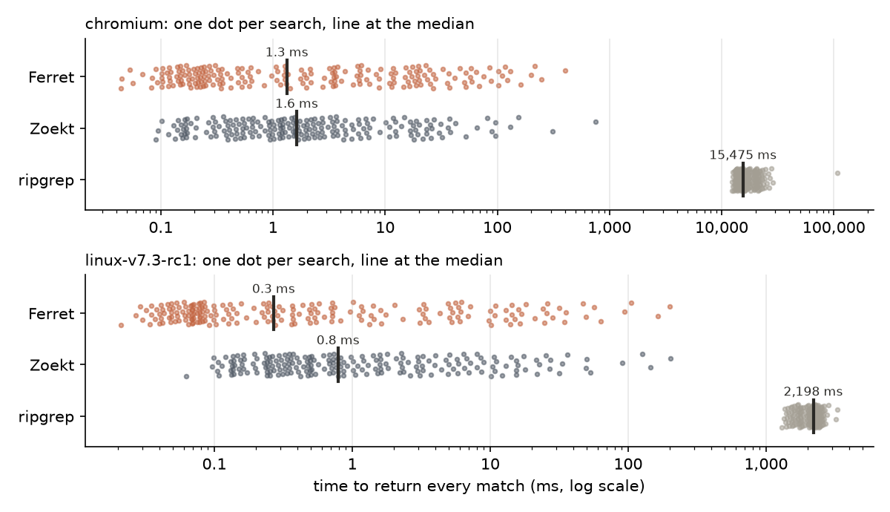
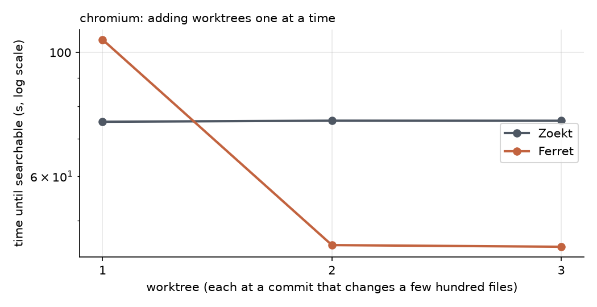
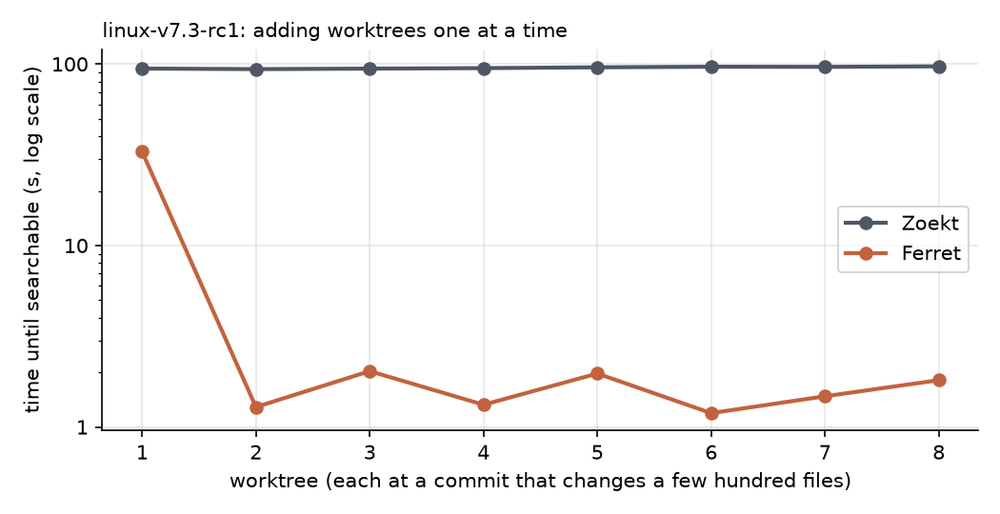
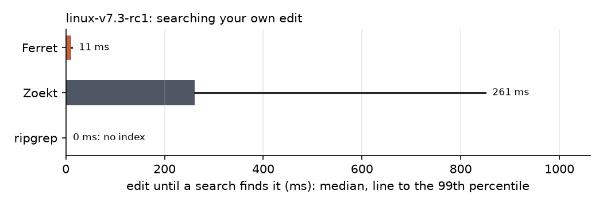

# Benchmarks

Ferret 4969570 (modified) on a Mac15,12, 16 GiB, 8 cores, macOS 15.6.1, AC Power; ripgrep 15.2.0; Zoekt v0.0.0-20260911061844-153817f643cd. Raw output: [chromium/](chromium), [linux/](linux). Rendered by `python -m bench.report`; bench/README.md has the method.

## 1. How long does a search take?

200 searches per repository, each returning every matching line.

| chromium | Ferret | Zoekt | ripgrep |
|---|---:|---:|---:|
| Median search | 1.3 ms | 1.6 ms | 15,475 ms |
| 95th percentile | 102 ms | 42 ms | 23,949 ms |
| Median, first waiting until recent edits are visible | 13 ms | never sees uncommitted edits | always reads the files |
| Same matches as ripgrep | 200 of 200 | 157 of 200 |  |
| Index size (build times: see 3) | 3.3 GiB | 6.6 GiB | no index |

| linux-v7.3-rc1 | Ferret | Zoekt | ripgrep |
|---|---:|---:|---:|
| Median search | 0.3 ms | 0.8 ms | 2,198 ms |
| 95th percentile | 32 ms | 27 ms | 2,582 ms |
| Median, first waiting until recent edits are visible | 11 ms | never sees uncommitted edits | always reads the files |
| Same matches as ripgrep | 200 of 200 | 189 of 200 |  |
| Index size (build times: see 3) | 1.7 GiB | 3.0 GiB | no index |

## 2. Does search slow down when agents search at once?

| linux-v7.3-rc1: agents at once | 1 | 2 | 4 | 8 |
|---|---:|---:|---:|---:|
| Ferret, median search | 15 ms | 16 ms | 12 ms | 14 ms |
| ripgrep, median search | 2,380 ms | 5,001 ms | 10,958 ms | 21,633 ms |

## 3. What does another worktree cost?

| chromium | Ferret: time | Ferret: disk added | Zoekt: time | Zoekt: disk added |
|---|---:|---:|---:|---:|
| First worktree (the whole repository) | 105 s | 3.3 GiB | 75 s | 6.6 GiB |
| Each further worktree, 2,309 files changed (median of 2) | 45 s | 18 MiB | 75 s | 32 MiB |
| A worktree at the same commit as the first | 45 s | 0 bytes |  |  |

| linux-v7.3-rc1 | Ferret: time | Ferret: disk added | Zoekt: time | Zoekt: disk added |
|---|---:|---:|---:|---:|
| First worktree (the whole repository) | 33 s | 1.7 GiB | 94 s | 3.0 GiB |
| Each further worktree, 479 files changed (median of 7) | 1.5 s | 10 MiB | 96 s | 14 MiB |
| A worktree at the same commit as the first | 1.1 s | 0 bytes |  |  |

## 4. How soon can an agent find its own edit?

| linux-v7.3-rc1: edit until a search finds it | Median | 99th percentile |
|---|---:|---:|
| Ferret (sees the file change) | 11 ms | 12 ms |
| Zoekt (commit, update the index, reload) | 261 ms | 850 ms |
| ripgrep (reads the files at every search) | 0 ms | 0 ms |

